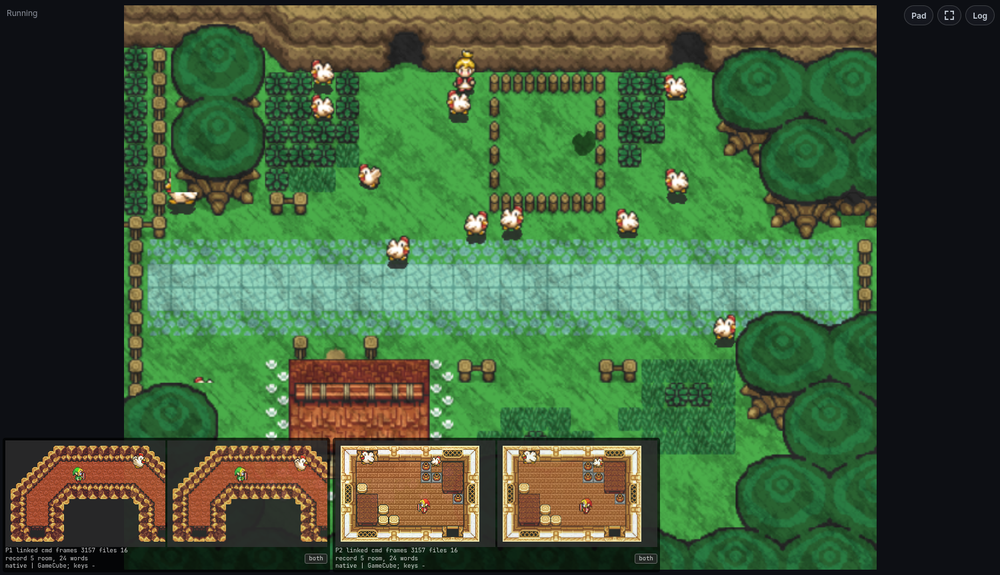
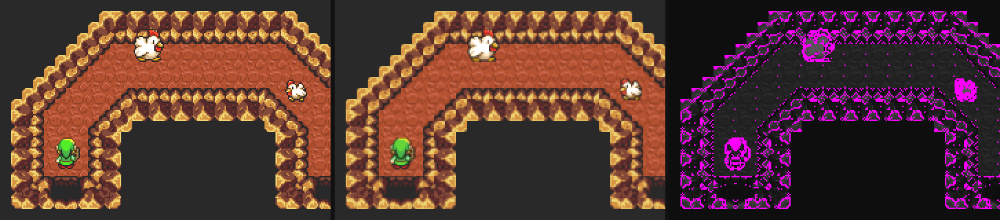
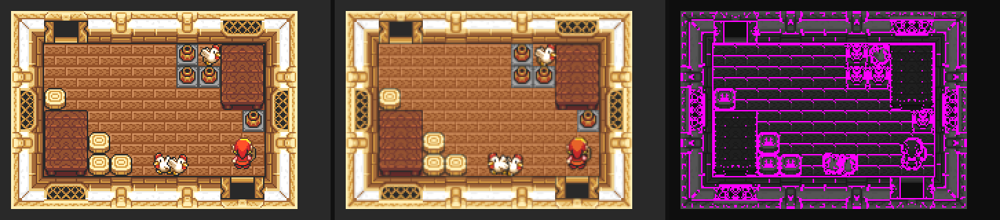
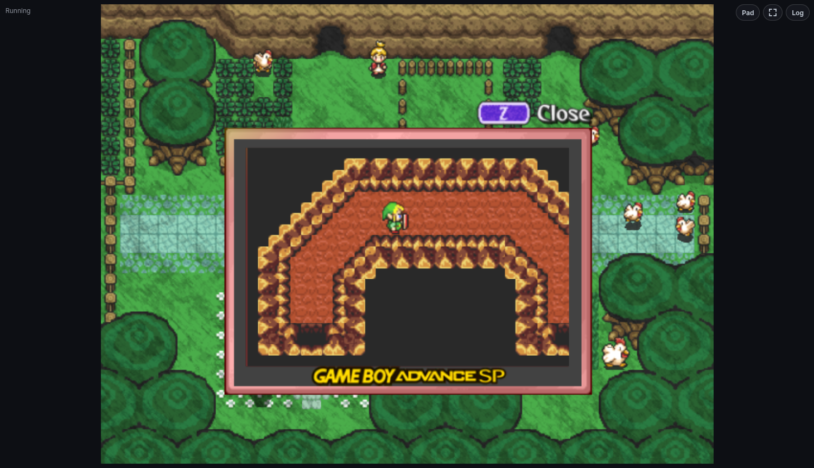

# Multiplayer (branch `deluxe`)

Four Swords Adventures is a four-player game in which every player holds a
Game Boy Advance: it is their controller and, inside houses, caves and the
underground, their own screen. The GameCube runs the one game; each GBA runs a
small client program the GameCube sends it over the controller cable, and from
then on the two exchange a few dozen bytes a frame.

This port keeps the game unmodified above that cable, as katam-port does with
the GBA link cable (`katamport/port/docs/MULTIPLAYER.md` §2). Below it, instead
of a GBA, a native endpoint answers the game: no GBA emulator, no client
program, only what the game checks, word by word.

This document is five things: what the game does on the link (§1, read from
the decompilation: `game/src/game/tu_803006E8.cpp`, `tu_803099FC.cpp`,
`tu_80301CD0.cpp`, `adv_entry_screen_803E1668.cpp`); the seam (§2); what is
implemented and verified (§3); each player's GBA screen, three approaches
("GBA screen"); and the options for remote play, with a recommendation (§4).
Open questions for the owner are in §5.

Conventions: **verified** = run in this branch's build, with the run named;
**read** = taken from the code without running it; **assumed** = neither.

---

## 1. What the game does

### Who is a GBA, and why multiplayer needs four of them

`cls_804AA8C8::pollInputs_8030A43C` (`tu_803099FC.cpp`), once a frame, looks
at each controller port through its GBA client (`lbl_804DB798[port]`,
`GbaClient_803007D0`). The client thread probes the port (`SIProbe`); if it
answers `SI_GBA` (0x40000) the port is a GBA and that player's buttons come
from the GBA's key word, otherwise from the GameCube pad (`JUTGamePad`). Both
paths fill the same per-player button word (`field_0x4[port]`), so the rest of
the game does not care. (read; verified for the GBA path)

The adventure's player-count screen (`AdvEntryScreen_804B0B00::fn_803EDBF0`)
counts players like this: a GameCube pad in port 1 means single-player only;
a GBA in port 1 plus GBAs in ports 2, 3, 4 *in a row* allow 2, 3, 4 players
(`field_0x1bc`). So **every player of a multiplayer game, player 1 included,
is a GBA**; a gap (GBA, pad, GBA) stops the count. (read; verified: with
`?gba=4` the menu offers all four counts, with `?gba=1` single-player only)

### The client thread and its messages

One thread per port (`fn_80300E1C`, started by `startGbaClients_803007D0`, priority
8) takes messages from `pollInputs_8030A43C` and drives the SDK's GBA calls:

| msg | what | when |
|---|---|---|
| 6 | `SIProbe`; 0x40000 = GBA (`mState`) | the port's type is unknown |
| 7 | `GBAJoyBoot` the client program, then as 8 | GBA present, not connected (`field_0xd8 == 0`) |
| 8 | `GBAReset`, then the handshake below | after boot |
| 5 / 4 / 3 | resend the session packet / acknowledge / drop and reprobe | posted by the packet callback `fn_80300A8C` when the GBA's packet differs |
| 10 | the frame: write the player's record, read the key word | every frame while connected, once the game has started (`lbl_8053AAF0->mState >= 4` or `field_0x60`) |

Every exchange has a timeout (0.5-1 s of `OSGetTime`) after which the client
is reported broken (`field_0xd3`), the port reprobed and the GBA rebooted.

### The handshake, word by word (what the endpoint answers)

`GBAGetStatus` returns the JOY status byte: `PSF1` 0x20 and `PSF0` 0x10 are
flags the GBA program sets, `SEND` 0x08 means the GBA has a word for the
GameCube, `RECV` 0x02 means the GameCube's last word is still unread.

1. `GBAJoyBoot(port, palette = {2,4,0,6}[port], speed 2, client_thread.bin)`.
   The game has patched the program's header first: the disc's game code at
   0xAC (`G4SE`), the header checksum at 0xBD, and a boot tick
   (`lbl_8053ACC8 = OSGetTick()`) at 0xC8.
2. `GBAReset`; status must be **0x28**; `GBARead` = the GBA's game code, which
   must equal the disc's (or `g4se`/`g4sj`).
3. status **0x20**; `GBAWrite` the disc id; status **0x30** ("session up").
4. `GBAWrite 0x04000000` ("send your packet"); 8 × (status **0x38**,
   `GBARead`) = the GBA's 32-byte session packet (`GbaPacket_80300A8C`).
5. `fn_80300A8C` compares it with the GameCube's copy for that port
   (`lbl_804D6AB8[port]`, which `GBAJoyBoot`'s success filled with
   `{1, port, 0, 1, boot tick, 0...}`). Equal: status **0x30**, `GBAWrite`
   a fresh tick, status **0x38**, `GBARead` must return the same tick. Then the
   client is **connected** (`field_0xd8 = 1`).
   Different: message 5 (`0x02000000` + the GameCube's 8 words, the GBA sends
   them back), 4 (`0x03000000`) or 3 (drop).
6. Each frame (message 10): status 0x30; `GBAWrite` the record's words; then,
   with `RECV` clear, `GBARead` the **key word**:

       bits 16-23  GBA keys 0-7 (A B Select Start Right Left Up Down)
       bits  8-9   GBA keys 8-9 (R L)
       bit  15     unknown (pollInputs copies it to field_0xe6)
       bits  0-7   check byte: fn_803006E8 (a CRC, polynomial 0xCD) over bits 8-23
       bits 24-31  the GBA's acknowledgement: 2 = file received, 3 = message received

   `pollInputs_8030A43C` maps the keys onto the pad's bits: A 0x100, B 0x200,
   Select 0x400 (the pad's X), Start 0x1000, the d-pad 1/2/4/8, R 0x20, L 0x40.

### The per-frame record

`lbl_80506DE8[player]` (`cls_804AA858Sub11C`, `game/Map.h`), built each frame by
`cls_804AA8B8::fn_80304FB0`. Its length depends on how many GBAs are linked
(`lbl_80541618`): **26 words with one, 24 with two, 16 with three, 12 with four**
(the link's bandwidth is shared). Word 0 is a checksum byte, the record kind and
header bits; word 1 depends on the frame's phase (`lbl_80506D48`, 0-3:
life, rupees/force gems, timers, ... in turn). By kind:

| kind | content |
|---|---|
| 5 | the regular view: four player marks (screen x, y, sprite) whose spare bits carry the BG scroll (9-bit x, y); up to 19 sprite words (10-bit id, x, y, kind, flags; sorted by kind); the layer mask word. `mValid` (header) is nonzero when the player is in a sub-area (layer >= 8) |
| 14 | the same for a player who is linked but not taking part |
| 9, 13 | nothing to show (menus, cutscenes, loading) |
| 6, 7, 8 | a file: 6 = header (byte-swapped flag and GBA address), 7 = data, 8 = the last chunk. The GameCube then waits up to 60 frames for ack 2 in the key word, else resends |
| 10, 11, 12 | a message's characters (16-bit codes, byte-swapped), 12 = the end; ack 3 |

The files (read: `fn_80303CE4`, `fn_803049F0`, `fn_80304B00`; verified: all
arrive and decompress):

| when | file | GBA address |
|---|---|---|
| after boot | sound_data, gb_ch_obj_base_sch, gb_cl_obj_base_scl, player_sch, bg_a_spl, player_sob, enemy_both_sob, enemy_both2_sob, moji_english_sch (all Yaz0), framed by end_code_scl.bin at 0xAAAAAAAA and 0xFFFFFFFF | 0x02033000, 0x06010000 (OBJ tiles), 0x05000201 (OBJ palette), 0x02034000, 0x0203C000, 0x02010000, 0x02021000, 0x02018E00, 0x02038000 |
| a stage starts | the stage's BG tiles and palette (24 KiB, 512 B) | 0x06000000, 0x05000001 |
| entering a room | the room's two view files (`fn_802D8128` / `fn_802D8228` names) | 0x0600C000, 0x0600E000 |
| some bosses | extra OBJ tiles (gb_ch_obj_tr_sch*) | 0x06017000 |

The boot set is about 80 KB on the wire. At 22 data words a frame (one or two
GBAs) it takes ~15 s, at 10 (four GBAs) ~33 s; the game plays meanwhile.

So **the GBA screen is drawn by the GBA from data it already holds**: tiles,
palettes and sprite definitions arrive once; each frame says where the camera
is and which sprites stand where. Nothing like a video frame crosses the link.
The GameCube has its own drawing of the same records too
(`TileMap_804AA858::drawPlayerPanel_802FB69C`, `fn_803022C4`, `fn_80302C34`: SOB
sprites at the records' positions), which is a reference for a native renderer.

### A port-only byte-order bug on this path

The client thread picks the frame's word count from `mTransfer[3] & 3`, the
record's `field_0x3_0` under MWCC's MSB-first bitfields. Under clang's
LSB-first layout that byte's low bits are the record *kind*, so the port sent
24 or 16 words where the game meant 12. Fixed under `FSA_PORT` in
`tu_803006E8.cpp` (`(mTransfer[3] >> 6) & 3`). It is a port endianness fix, not
a decomp bug, and only reachable with a GBA attached.

---

## 2. The seam

```
 game (unmodified)                         platform (deluxe)
 ─────────────────                         ─────────────────
 pollInputs_8030A43C ─ msgs ─► client thread fn_80300E1C
                                   │ SIProbe ───────────► aurora_si_probe_hook ─┐
                                   │ GBAJoyBoot/Reset/                           │
                                   │ GetStatus/Read/Write ─► gba_link.cpp: one   │
                                   │                         endpoint per port ◄─┘
                                   │                           │ keys()   ▲
                                   │                           ▼ record() │ file()
                                   │                         FsaGbaPeer (swappable)
                                   │                           local: PADStatus[port]
                                   │                                  + gba_view.cpp
```

`platform/gba_link.h`:

```c
struct FsaGbaPeer {
  const char* name;
  u16  (*keys)(struct FsaGbaPeer* p, int chan);                 /* GBA_* bits, answer at once */
  void (*record)(struct FsaGbaPeer* p, int chan, const u32* words, int count);
  void (*file)(struct FsaGbaPeer* p, int chan, u32 address, const u8* bytes, u32 size, int flag);
  void* user;
};
int FsaGbaAttach(int chan, struct FsaGbaPeer* peer);   /* NULL = the local peer */
int FsaGbaDetach(int chan);
```

- **The game does not change** (one port byte-order fix aside, §1). The
  endpoint (`platform/gba_link.cpp`) implements the SDK's GBA calls and plays
  the client program's side of §1: status flags, the handshake, the packet
  echo, the tick echo, the record, the key word and its acknowledgements.
  `SIProbe` gets one hook in Aurora (`extern/aurora/lib/dolphin/si/si.cpp`,
  `aurora_si_probe_hook`); with nothing attached the GBA calls answer
  `GBA_NOT_READY` as the old stubs did.
- **What is swappable is the peer**, the player behind the GBA: who presses
  its buttons and who looks at its screen. Katam's `PortMpTransport` answers
  "what did the other *game instances* put on the cable"; here the other end
  of every cable is a thin client, so the peer interface is *keys up, records
  and files down*. A network peer buffers keys from a socket (`keys` must
  answer at once: it runs inside the game's client thread) and forwards records
  and files to a remote screen.
- **The local peer** takes a GBA's keys from `PADStatus[port]` as the game read
  it at the latest `JUTGamePad::read` (hook in `platform/input.cpp`, after the
  harness), so keyboard, gamepads and the harness's four pads all drive GBAs,
  and lockstep runs stay deterministic. It feeds the native view.
- **The native view** (`platform/gba_view.cpp`): a GBA memory image per port
  (EWRAM, palette RAM, VRAM) with the files placed at their addresses (Yaz0
  decoded), the latest record decoded, and the 240 × 160 GBA screen rebuilt
  from them ("GBA screen", approach A).
- **The page** (`platform/web/fsa_gba.js`): `?gba=N` plugs GBAs into ports
  0..N-1 (`?gba=0,2` for a list), `?gbaview=0` hides the panel,
  `?gbaview=native|gc|both` picks how it draws ("GBA screen"), `?gbascale=S`
  (or `?gbaview=S`) scales it. Live keys for ports 2-4: IJKL/U/O/P, TFGH/R/Y/V, arrows/Numpad1-3
  (ORed with that port's gamepad). `window.fsaGba` has `attach(port, on)`
  (hot-plug), `link(port)`, `view(port)`, `memory(port, region, len)`,
  `dump()`.
- **The harness** drives four pads in scripts: a step may say `"pad": 0-3`
  (`docs/HARNESS.md`). The state stream has the player-count screen's state,
  cursor and connected count (`lbl_8053AD98->field_0x4->field_0x1d4/1bc/1d0`).

---

## 3. What is implemented, and verified

| | |
|---|---|
| `platform/gba_link.{h,cpp}`: SDK GBA calls, endpoint, local peer, page exports | done |
| `extern/aurora/lib/dolphin/si/si.cpp`: `SIProbe` hook | done |
| `platform/gba_view.cpp`: files, Yaz0, records, the native GBA screen (approach A) | done for rooms ("GBA screen") |
| `game/src/port/gba_gcview.cpp` + Aurora readback: the GameCube-drawn GBA screen (approach B) | done ("GBA screen") |
| `platform/web/fsa_gba.js`: `?gba=`, keys for ports 2-4, panel | done |
| harness: `"pad"` on script steps, entry-screen globals; `tools/harness_scripts/mp_{2,3,4}_stage_1_0.json` | done |
| the client's own screens (overworld, messages, HUD) | **not known** without the client (docs/GBA-CLIENT.md) |
| a network peer, rooms | **not done**: the decision of §4 comes first |

Runs (build of this branch, `tools/serve.py --diag logs/diag-mp`, own Chromium
on CDP 9363; run directories under `logs/diag-mp/` in the main checkout,
screenshots in `logs/multiplayer/`):

- **The link comes up**: every GBA boots, handshakes and connects
  (`field_0xd8 = 1`) within a few frames of the boot loader; 14 files per GBA
  arrive, are acknowledged and decompress to their stated sizes; records of
  kinds 5/6/7/8/9/13 flow every frame, 12/16/24/26 words long per GBA count
  (`fsaGba.dump()`). (verified)
- **The game takes 2, 3 and 4 players**: the player-count menu shows the GBAs
  (`menu-four-gbas.png`); `mp_N_stage_1_0.json` picks N players and enters
  stage 1-0 with `mPlayerMask` 0x33 / 0x77 / 0xFF (runs
  `20261125-213454-1r19idk1`, `-213904-t6fyt177`, `-212642-dzvoe6o6`); the HUD
  shows N players (`stage-1-0-two-players.png`, `stage-1-0-four-players.png`).
- **Each GBA drives its own player**: in the four-player run each pad's step
  moves only that player (state stream, run `20261125-211910-ow6x5zz9`): pad 0
  right x 40→127, pad 1 down y 488→544, pad 2 left (to the wall), pad 3 up
  y 472→423, then each back.
- **Deterministic**: the four-player script twice (`fast=1`): sync 324/324,
  state 319/319 identical over 16,719 reads, inputs identical
  (`-212642-dzvoe6o6` vs `-212754-fmuck9v6`).
- **No regression without GBAs**: `opening.json` on main c425eb8 and on this
  branch without `?gba`: sync 89/89, state 85/85 identical over 4,418 reads
  (the three new state globals stripped; `-213033-9es96hno` vs
  `-213358-n78k6jgk`).
- **The data is right**: the OBJ tiles the game sends render as the GBA's
  sprites (Link, hearts, rupees, the font: `gba-obj-tiles.png`).

Since verified ("GBA screen"): sub-area views (kind-5 records with `mValid`
set, the room files 0x0600C000 / 0x0600E000), with
`mp_2_stage_1_2_rooms.json`. Not verified: message records (10-12); unplugging and replugging mid-game (the code path
exists: `fsaGba.attach(p, 0)`, the game's own timeouts and reprobe); Tetra's
Trackers / Navi Trackers / Shadow Battle modes (`connect_screen_803F0A54.cpp`
counts GBAs the same way; untested).

Note: `fn_80300E1C` is a 72 % "behaviour drift" match in the decomp. The
protocol above works through it as built; differences from the original that
only show with a real GBA's timing (stalls, retries) would not show here.

---

## GBA screen: three approaches

Each player's GBA screen (240 x 160) can be had three ways; the page shows
the first two, switchable per panel. Verified runs: build of this branch,
`tools/serve.py --diag logs/diag-gbav`, own Chromium (CDP 9369); run
directories `logs/diag-gbav/<run>` and the shots in `logs/gba-screen/` of the
main checkout.

### Where a player sees their GBA screen

The game shows a player on their GBA while they are in a sub-area (a house, a
cave, the underground: player layer >= 8; the record's `mValid` is the layer
- 7). `tools/harness_scripts/mp_2_stage_1_2_rooms.json` gets there: two
players, stage 1-2 (a cave entrance two steps from the start, warp at
(1216, 3496) -> layer 12, and a house below it, warp (1200, 3768) -> layer 9);
player 1 walks into the cave, player 2 round the house and in at its door
(verified: state stream, players' `mLayer_0x3b4` 12 and 9). Entering a room
sends that GBA the room's two tile grids (0x0600C000 / 0x0600E000), which
earlier runs had never seen.

### (A) Native rebuild (`platform/gba_view.cpp`)

The GBA memory image per port (files at their addresses) is drawn like a GBA:
the room grid at 0x0600E000 as metatiles (bg_a_spl at 0x0203C000: four BG map
entries each) of the stage's BG characters (0x06000000) and palettes,
scrolled by the record's 9-bit scroll; the sprite table (each record's words
replace the half its phase selects, as the GameCube's own copy does,
`fn_803068D0`) and the four player marks, each the frame `id` of a "SOB "
resource (6-byte GBA OAM entries; OBJ characters from VRAM 0x06010000 or the
player sheet in EWRAM; OBJ palettes; flips, 2x, mirror, translucency, player
colours); sorted by (kind key, y), the overlay grid 0x0600C000 between keys
< 2 and >= 2. The rules are the GameCube's drawing of the same records
(below); what neither the data nor the GameCube says is listed in
[GBA-CLIENT.md](GBA-CLIENT.md) (the overworld screen, messages, the client's
OBJ VRAM use, effects). On the overworld the rebuild shows the backdrop only.

### (B) The GameCube's own drawing (`game/src/port/gba_gcview.cpp`)

**The single-player path.** In single player, entering a house or cave makes
the TV show a "Game Boy Advance SP" window with the room in GBA style. That is
`GameRoot2_8049F108::fn_8013B618` -> `TileMap_804AA858::drawPlayerPanels_802FF0EC`
-> `drawPlayerPanel_802FB69C(player, field_0x11c[player], rect, viewport,
flag, count, alpha)`: an orthographic box of 240 x 160 GBA pixels (`rect`)
into a TV viewport (`viewport`), drawing the room layers (`fn_802FAC10`), the
sprite table and marks (`fn_8030275C`, `fn_803022C4`) of the player's record.
It keys on **the record**: `field_0x11c[p]` is the GameCube's copy of the
record it sends GBA `p` (`fn_802F53F4`, called from `fn_80304FB0` for every
linked player, single or multi), and `fn_802FCE74` decides where (and
whether) the TV shows it: in single player the big window (`field_0x7e` 0,
player 0 only), in multiplayer small 48 x 48 corner views or nothing. So it
can be driven per player without touching gameplay: the records exist for
every linked player whatever the TV shows.

**Reuse.** At the end of each game frame (`platform_frame_end`, before Aurora
ends the frame) the hook draws, for each requested port whose current record
is a room view, `drawPlayerPanel_802FB69C(p, field_0x11c[p], {0,0,240,160},
{port's cell}, 1, 0, 0xFF)` into an Aurora offscreen framebuffer (2 x 2 cells
of 240 x 160), and reads it back for the page (new in Aurora:
`AuroraReadbackFrameBuffer` / `AuroraReadbackLatest` / `AuroraReadbackPending`,
a `CopyTextureToBuffer` + `MapAsync` of the offscreen pass; one in flight, so
the panels follow at the GPU's pace, a few frames late). The draw writes some
game objects (the camera's view box and matrices in `fn_8030DD8C`, the
player's line-shift state in `cls_804AA8D8::fn_8030B1E8`, TileMap queues), so
the hook saves the TileMap, the camera and that object before and restores
them after, byte for byte. Off unless the page asks (`fsa_gba_gcview(mask)`).
In netplay the same pixels could go to that player's own screen.

### The page

`?gba=N&gbaview=native|gc|both` (default native); a button on each panel
cycles the mode; `?gbascale=S` sets the size (`?gbaview=S` still works). In
`gc` mode a port that is not in a room shows the native view (the GameCube
draws rooms only). `?gbashots=1` logs a side-by-side shot of each port when
its screen settles (overworld / room), `fsaGba.shot(p)` / `fsaGba.logShot(name,
p)` on demand; `tools/gba_shots.py console.log DIR` writes them as PNGs. A shot
compares the GameCube panel with the native screen **of the same frame** (the
hook keeps the native rendering of each frame it draws).



### A and B side by side (same frames)

`mp_2_stage_1_2_rooms.json`, `?gba=2&gbaview=both&gbashots=1`, run
`20261125-230416-qw10sern`. Each picture: native | GameCube | difference
(magenta: a channel differs by more than 24).

Cave (player 1, layer 12; read 1491; 10.3 % of pixels differ):


House (player 2, layer 9; read 2440; 17.0 % differ):


Overworld (player 2 at the start, read 1357): the GameCube draws nothing; the
native screen is the backdrop (what the client shows here is not known):


- **Structure matches**: the same room, layers, objects (pots, stools, bed,
  fire place), the same sprites at the same places, the player's Link with
  their colours, the cuccos that followed them in. (verified, the pictures)
- **The colours differ by design**: the GBA is sent its own palettes
  (`gb_cl_obj_base_scl`, the stage's GBA palette), the GameCube draws with
  its own (`cu_cl_obj_base_scl`, `adjustChannel`) through RGB5A3 textures;
  nearly all of the magenta is dark outline and shading colours mapping to
  different values (e.g. native #945229 vs GameCube #b16f42), not misplaced
  pixels.
- **Spin**: a "turning" word (`field_0x3_3`, a cucco) is turned by the
  GameCube's angle on one side and the rebuild's own on the other, so it can
  face the other way.
- **Messages**: no run of ours has produced a message record (kinds 10-12:
  sent while that player's own message window is open,
  `getMessageWindowState_8037F1E4(player) == 3`; talking to the girl at the
  start of 1-2 opens the shared TV window instead, no GBA message). The
  GameCube's panel never draws text either. Not compared.
- **Dolphin**: not done. The decomp's harness (`harness_dolphin.py`) sets
  `SIDevice0 = 6` (a standard controller) and has no GBA device or screen
  capture; its Dolphin is built with mGBA (`USE_MGBA=ON`), but a GBA BIOS and
  a harness change (SI device "GBA (integrated)", per-player GBA frame
  dumps) would be needed, and the harness is read-only for us.

### Gameplay does not change

- **Without GBAs**: `stage_1_0.json` (`fast=1`, `nosave=1`) on this branch and
  on the main build (`build/web` of the main checkout): sync 918/918, state
  914/914 identical over 28,478 reads (runs `20261125-225222-2q0d0z9c`,
  `20261125-225527-mslrfzh1`; the three deluxe entry-screen globals stripped,
  as in §3).
- **With GBAs, B on vs off**: `mp_2_stage_1_2_rooms.json` with
  `gbaview=both&gbashots=1` and with `gbaview=native`: sync 97/97, state
  92/92 identical over 4,424 reads (runs `20261125-225054-jn3wlf2v`,
  `20261125-225135-i77c8h6i`).

### A port bug found on the way (fixed): the player vanished from GBA views

With the views working, neither showed the player's own Link in a room, and
neither did single player's TV window (`sp-tv-gba-window-before-fix.png`).
`cls_804AA8B8::fn_80306A94` places mark `fn_802340A0(i)` for each player `i`;
`fn_802340A0` (`tu_8022AD64.cpp`) has no return for an inactive player: the
original returns `r3` unchanged, i.e. `player` (the decomp notes this,
"Missing final return"), while clang returns an undefined value (0 here), so
every inactive player's hidden mark overwrote mark 0. Fixed under `FSA_PORT`
(`return player;`). It is reached only by the record builder (records,
the TV's GBA-style windows), so game state is unchanged (the comparisons
above are with the fix). Single player's cave window now shows Link:



### (C) Decompiling the client

Not done here. Its location, format and the behaviours (A) guesses are in
[GBA-CLIENT.md](GBA-CLIENT.md), a brief for the decomp session.

### Which to use

B is exact by construction for rooms (it is the game's own GBA-style drawing)
and cheap to keep, but it needs the host's GPU, so it serves a host-side view
(a TV corner, a streamed panel); it draws nothing on the overworld and no
text. A runs anywhere the files and records go (a phone in netplay, §4 (b))
and matches B's structure; its gaps are the client's own screens (overworld,
messages, HUD), which only (C) can settle. Recommendation: A for the phones,
B as the reference A is checked against (`gbaview=both`), and the decomp's
client (C) to fill A's gaps.

---

## 4. Remote play: the options, mapped from katam-port

What Katam learned (`katamport/port/docs/NETPLAY.md`, `NETPLAY-HANDOFF.md`):
the seam under the game was right; rooms on Cloudflare (partyserver Durable
Objects, room codes) worked; v1 lockstep over the cable was sound but stalls;
v2 rollback with periodic world syncs desynced and rubber-banded beyond ~60 ms
one way and was shelved; its recommended direction was **host-authoritative
state streaming**, because consistency should be structural, not earned
through determinism.

FSA's own design points the same way: the GameCube is a host and every GBA a
thin client by construction.

### (a) Every browser runs the whole game; inputs are exchanged

Each browser loads the disc and runs the simulation; per frame the four GBA
key words (in practice the four `PADStatus`, the harness's input record) are
exchanged, and each browser draws its own player's GBA view (it has all the
state).

- For: the harness has shown the port deterministic (inputs indexed by pad
  read, port vs Dolphin identical over 25k reads; four GBAs here identical
  run to run, §3). Bandwidth is trivial (a few bytes a frame).
- Lockstep (wait for frame n's inputs from everyone): input delay of half an
  RTT plus jitter margin for everyone, and a stall whenever anyone is late.
  Katam's Path A shows it works; it feels bad beyond ~50-80 ms.
- Rollback: needs snapshot/restore of the whole game. Katam's was a memcpy
  of the GBA memory map with a stackless loop at the hook. FSA has the JKR
  heaps, globals, **several OS threads with suspended JSPI stacks** (game,
  audio, DVD, the four GBA clients), the DSP mixer and Aurora's state:
  restoring means restoring threads mid-call. Not available today and not
  small. And Katam's v2 shows the failure mode when the window is shorter
  than the lead.
- Every player needs the disc (1.4 GB; the README notes iOS kills a tab
  holding that much) and a desktop-class device to run it.
- Desync risk across browsers/GPUs/builds is unmeasured (same build, same
  machine only so far); the audio thread's wake-ups are not pinned (HARNESS.md).

### (b) Host-authoritative: the host is the GameCube, phones are the GBAs

One browser (the host) runs the game. Each remote player's phone is that
player's GBA: it sends its buttons up and receives exactly what a GBA would,
the records and files, and draws the GBA screen natively. Nothing else needs to
be built into the game: a network `FsaGbaPeer` on the host, the native GBA
renderer on the phone.

- Traffic per player: up 2 bytes of keys a frame (~120 B/s); down one record
  a frame (≤ 104 B, ~6 KB/s) plus the file bursts (~80 KB at boot, a few KB per
  room). The game designed this for a 1 Mbit/s cable shared by four.
- No determinism needed, no desync possible, no disc on the phones (only the
  host has it; the phone gets the GBA's files, as a real GBA did).
- Latency lands where the game expects it: `keys()` answers at once from the
  latest buffered keys, so the host never stalls on the network; a remote
  player's input arrives RTT/2 late. The link's own timeouts are between the
  game and the local endpoint, never on the network. File acknowledgements can
  take the RTT; the game waits up to 60 frames before resending.
- The TV picture is shared: players in the same room look at the host's
  screen (the original party setup, phones instead of GBAs, no video at all).
  Players elsewhere need the TV streamed: a WebRTC video track of the host
  canvas (`canvas.captureStream()`; 1-3 Mbit/s, ~100-200 ms), or later a
  "TV view" sent as state, which is a much bigger job.
- Transport: Katam's v1 room pieces carry over (room codes, a relay room per
  session on Cloudflare); the host is a room member that owns the game. A
  WebRTC data channel between host and phones is the low-latency variant, with
  the room only for signalling.

### Recommendation: (b), in two steps

1. **Same-room play first**: the host page on the TV or laptop, each player's
   phone joins with a room code and becomes their GBA (screen + touch pad).
   Needs: the native GBA renderer (needed by any option), a network peer, a
   phone page. No video, no determinism, no rollback.
2. **Remote players**: add the TV as a WebRTC video stream to the same session.

Why: it is how the game is built (the GameCube already treats GBAs as thin
clients over a slow link, §1); Katam's measured lesson is that structural
consistency beats earned determinism on real networks; phones cannot hold the
disc; and the work is mostly the GBA renderer, which (a) needs as well. (a)
stays possible later for remote play without video, as plain lockstep (the
harness's pad-read index is the frame number), if (b)'s video latency proves
unacceptable.

Verified vs assumed for this recommendation: the record and file traffic and
its sizes are measured (§3); that a GBA screen can be rebuilt from them
natively is **verified for rooms** (the native rebuild matches the
GameCube's own drawing of the same records, "GBA screen"; the overworld,
message and HUD screens of the client are not known); the network latency
behaviour is read from the code (the game reads keys, it never waits for
them), not measured over a network.

---

### What was built (owner's choice: (a) with rollback)

Every browser runs the whole game and inputs travel, with rollback, lockstep as
a mode: docs/NETPLAY.md (design, protocol, how to run, measurements).

## 5. Open questions for the owner

1. **(a) or (b)?** §4 recommends (b), same-room first.
2. **How faithful must the GBA screen be?** All three tried ("GBA screen"):
   (i) the native rebuild and (ii) the GameCube-drawn view both work for
   rooms and agree in structure; (iii), the client's decompilation, is with
   the decomp session (brief: GBA-CLIENT.md) and is what the overworld,
   message and HUD screens need. Recommendation there: (i) for phones, (ii)
   as its reference.
3. **Player 1 on the TV device**: in a same-room session, should player 1 also
   be a phone, or the host's keyboard/pad with a GBA view on the TV corner?
   The game requires player 1 to be a GBA for multiplayer, which the endpoint
   satisfies either way.
4. **Single-player with a GBA** (`?gba=1`): the game then sends the GBA views
   for single-player too. Worth exposing (a phone as a second screen in
   single-player), or keep single-player on the pad only?
5. **What the GBA shows on the overworld** (record `mValid` 0): not known
   (the GameCube draws no panel then); the native rebuild shows the backdrop
   until the client's decompilation says (GBA-CLIENT.md, item 1).
6. The four-pad harness extension (`"pad"`) and the entry-screen globals are
   generic: forward them to main?
