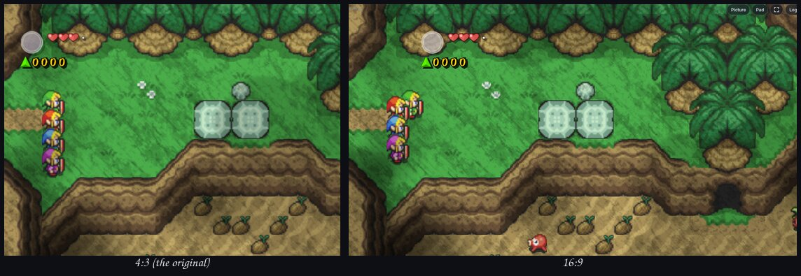
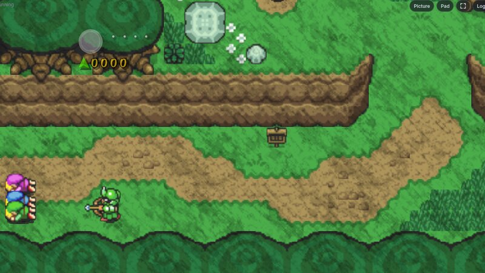
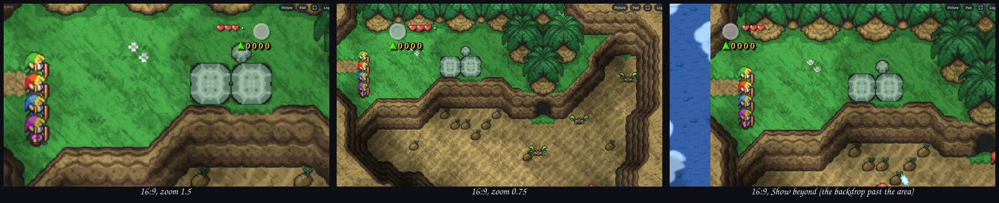
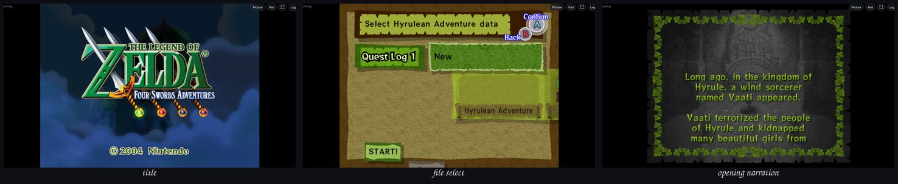
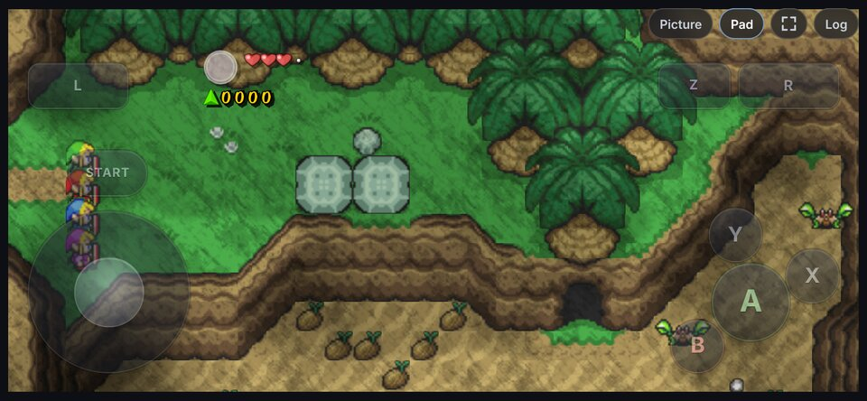
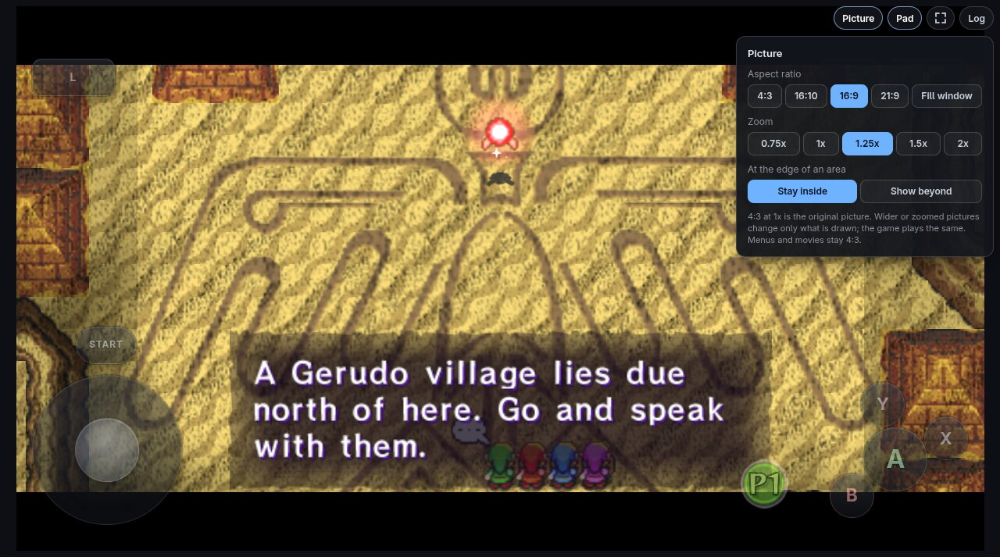
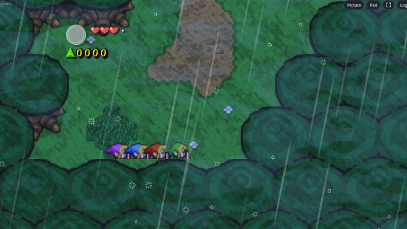
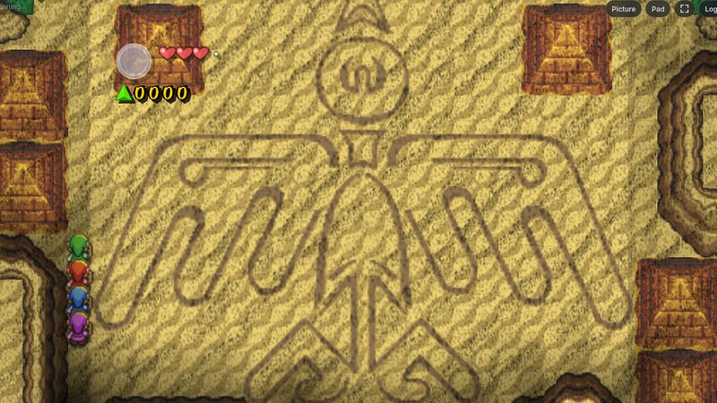

# The picture: widescreen, fill-window and zoom

A `deluxe` feature. On the page, **Picture** (top bar) picks the aspect ratio
(4:3, 16:10, 16:9, 21:9, or the window's own), a zoom (0.75x to 2x) and what to
do at the edge of an area. The default, 4:3 at 1x, is the game as it shipped:
nothing in this document does anything then.

The short version:

| | verdict |
|---|---|
| **Widescreen / fill window** | works everywhere tested; the world is drawn wider, the game still plays its 4:3 view |
| **Zoom in** (crop and scale) | works; the HUD stays put, its world markers follow the zoom |
| **Zoom out** | works inside an area; an area is only about one zoomed-out screen, so it is limited by the area (or shows the backdrop with "Show beyond") |
| **Gameplay** | identical in every mode: the same scripted runs give the same state records at the default, at 16:9 x1.25, at 2.17:1 x0.75 and at 16:9 (stage 5) as a `main` build |
| **Wider culling** | not needed and not offered: nothing in FSA culls drawing by the camera, and the game's "on screen" rules are left 4:3 on purpose |



## How it works: the game keeps its 4:3 view

Katam's port widened the game's own view and then had to widen everything that
depended on it: OAM culls, object alive and spawn windows, the camera clamp.
FSA is built differently, and that allows the opposite approach. **The
simulation is not touched at all.** The camera still frames the players in its
4:3 box, clamps that box to the area, and every "is it on screen" test still
asks about that box. Only the drawing changes: at the moment the camera loads
its projection into GX, the projection and viewport are swapped for a wider
(or cropped) *render box* derived from the camera's box. Nothing the game
reads back (its stored matrices, `mViewBox_0x164`, `worldToScreen_8030C5F0`,
`isOnScreen_8030C2A8`) changes, which is why the state records match.

What makes that possible in FSA, and was not true of KATAM:

- **Actors live per area, not per screen.** Sprites are culled against the
  game view's area box (`tile_map_802F5040.cpp`, `isOnScreen` inline:
  `GameView::mVisibleBox`), not the camera; actors exist for the whole area.
  So the wider picture already has its enemies in it (the soldier at the left
  edge below, the Tektites and Octoroks in stage 1).
- **The tile map draws the whole area.** `TileMap fn_802FC268` draws the
  area's grid (up to 64 x 64 cells of 8 units from the area origin
  `mLayerOrigin_0x2368`), not a window around the camera, so there are no
  holes or repeats anywhere inside the area. Outside it there is nothing.



## What "4:3" turns out to mean in FSA

Where the shape of the screen is written down, and what this mod does with each:

| Where | What | Here |
|---|---|---|
| render mode `lbl_8049F090` (`tu_8013AAD4.cpp`) | the 608 x 448 EFB / XFB, shown 4:3 on a TV (non-square pixels) | unchanged: still the game's logical frame |
| Aurora (`extern/aurora/lib/gx/gx.cpp` `logical_mapping`) | the logical frame stretched over the canvas | **pillarboxed**: 608 x 448 maps to a 4:3 box in the middle of a wider canvas (`AuroraSetContentAspect`); viewports, scissors and EFB copies all go through it |
| the page (`index.html` `fit()`, SDL window 640 x 480) | the canvas: 4:3 | 480 x aspect by 480 pixels; CSS box of the same aspect |
| camera `fn_8030CD18` | the box framing the players: aspect `efbH / fbW`, clamped to the area (`mVisibleBox_0x154`), with a margin of 64-104 units around the players and a minimum half width of 130-142 (`lbl_804AA8E8`) | **unchanged** (the simulation) |
| camera `fn_8030CB10` / `loadGXState_8030DFE8` | the ortho projection from the box, viewport / scissor = the screen rect (608 x 448) | **replaced at load time** by the render box (below) and the whole render target as viewport (`fsaViewLoadWorld`); only for the camera's own view on the full screen |
| camera `fn_8030DD8C` | a box of its own: the map screen, the players' GBA panels | unchanged (left 4:3) |
| `TileMap fn_802FC268` | the area's tile grid | nothing to do: draws the whole area |
| sprite draw cull (`tile_map` `isOnScreen` inline) | the game view's area box | nothing to do |
| `Camera::isOnScreen_8030C2A8`, `mViewBox_0x164` readers | gameplay "on screen": players kept on screen (`player_8023FBF0` `fn_80241DD0`, `fn_80241BA0`), doors, force gems, thwomp switch, `act_four_girls_control`, `act_unknown_endm` | **unchanged on purpose** (see "Culling") |
| `game_root_sub_24` `pool_8053D938` + `GameRoot2::fn_8013B460` | full-screen world overlays (clouds, water, river bed, darkness of `shadow_circle`): a screen quad whose texture coordinates come from the camera's view | the quad covers the whole render target and its texture coordinates come from the render box |
| `GameRoot2::field_0x10` (`setPort_8013B490`), letterbox bars | the full-screen 2D port | while the world is widened its ortho also covers the side bars (`J2DOrthoGraph::setPort`); 0..608 still lands in the 4:3 middle |
| fades: `cls_80119E5C fn_801194C4` (the stage fade, 0..608), `BlackFade` (800 x 640 from x = 0) | full-screen `kk_black` quads that start at x = 0 | widened to the whole picture (`fsa_view_cover`): starting at 0 they left the left bar bright during a fade-in (seen, fixed) |
| HUD markers and corner tests: `adventure_hud` / `battle_hud` player markers, `rupee_digit_sprites`, `hud_mgr` (`fn_8043E7CC`, `fn_8043E398`, `fn_8043DF8C`, the bottom-edge test) | 2D positions from `worldToScreen_8030C5F0` | moved to where the render box shows that world position (`FSA_VIEW_HUD_POINT`); drawing only |
| THP movies, menus, title, file select, map screen | their own 2D / ortho at the logical size | pillarboxed |

### The render box

`platform/view.cpp` `fsa_view_render_box()` takes the camera's box *S* (read
back from the matrices just loaded, so it is exactly what the game is
drawing), the area *B* and the players' box *F* (`mPrevFocusBox_0x1b4`).

- The world keeps its scale on each axis: S fills the 4:3 middle of the
  canvas, so a 16:9 canvas shows 1.33 times as much world across.
- Zoom divides both sides (1.5x shows two thirds of S, centred, enlarged).
- **Stay inside** (default): if the result is wider or taller than the area,
  it is shrunk until it fits, which crops (zooms in) instead of showing past
  the area, but never so far that the players' box plus 24 units no longer
  fits; then it is moved to contain the players and kept inside the area.
  During an area transition B is the union of the two areas.
- **Show beyond**: centred on S, never clamped; past the area there is the
  stage's backdrop (water and clouds in stage 1).

Because the render box can sit off-centre against S (at an area's edge the
camera stops and the extra width all goes to one side), the 2D layer and the
world no longer line up by themselves. Everything world-anchored that the
game draws in 3D is fine (the world is drawn with the new projection); the
2D things listed in the table are moved explicitly.

## Modes

| Setting | URL | What |
|---|---|---|
| Aspect 4:3 / 16:10 / 16:9 / 21:9 | `?aspect=16:9` (or any `W:H` or number, 4:3 to 3:1) | canvas 480 x aspect by 480; world widened |
| Fill window | `?aspect=fit` | the stage's own aspect (rounded to 1/50, clamped to 4:3 .. 3:1), followed on resize and rotation |
| Zoom | `?zoom=1.25` (0.5 to 3; the panel offers 0.75 to 2) | > 1 crops and enlarges, < 1 shows more (inside the area) |
| At the edge of an area | `?edge=fit` (Stay inside) / `?edge=free` (Show beyond) | see above |

The choice is saved per viewer (`localStorage` `fsaport.view`, best effort);
URL parameters win for that visit and are not saved. `platform/web/view.js`
owns the button, panel and styles; `index.html` only asks it for the aspect
when it sizes the canvas. The touch pads (`touch.js`) re-lay out through the
page's `layoutHooks` as before.





A phone in landscape (844 x 390, `--viewport 844x390,mobile`), Fill window
(2.22:1), with the on-screen pads. In 4:3 the pads sit in the margins beside
the picture; filling the window puts them over the picture's extra width,
which is mostly where they land (the 4:3 middle, with the HUD, stays clear
except for the edge of the stick):



The panel, switched at run time (16:9, 1.25x) during a stage-5 cutscene:
the message window stays in the 4:3 middle, the cinematic bars cover the
whole width.



## Verified

Scripted runs (the decomp's harness scripts, 27818 pad reads each,
`?fast=1&nosave=1`, `tools/harness_compare.py`), against a build of `main`
at f9353c5 served the same way:

| script | this branch | sync | state |
|---|---|---|---|
| `stage_1_0` | default view (2f4c66a; again at 7ec7f05) | 923/923 identical | 919/919 identical (`state.jsonl` byte-identical up to the shorter run) |
| `stage_1_0` | `?aspect=16:9&zoom=1.25` | 922/922 identical | 918/918 identical |
| `stage_1_0` | `?aspect=2.17&zoom=0.75&edge=free` | 923/923 identical | 919/919 identical |
| `stage_5_0` (desert: heat haze, screen captures) | `?aspect=16:9` | 914/914 identical | 910/910 identical |

(The record counts differ by a few only because the runs stop at slightly
different reads after `script_end`.) So the mod does not change gameplay at
the default, and does not change it in the other modes either: nothing it
does is read back by the game. Run directories (main checkout, `logs/diag/`):
main `20261125-221158-m9ircp7g` / `20261125-224318-eda0qpd3`, this branch
`20261125-220919-ot785o9n` and `20261125-224819-x8vdagip` (default), `20261125-221455-s89hcso7` (16:9 x1.25),
`20261125-221719-g81doq9m` (2.17 x0.75 free), `20261125-222647-pyudgoby`
(stage 5, 16:9).

Screenshots, 16:9 unless noted, from scripted runs of stages 1-0 to 7-0 and
`?stage=` jumps (`build/web-run/st*` in the worktree):

- enemies present at the new edges and animated (a soldier in 2-0, Tektites
  and Octoroks in 1-0, Zols and ghosts in 4-0);
- no tile-map holes or repeats inside an area (the grid is the whole area);
- no void at area edges with Stay inside; the stage's backdrop with Show
  beyond;
- rain and lightning (3-0), the cloud shadows (4-0) and the darkness pass
  cover the whole picture; the cinematic bars of the stage-start messages
  and the stage-entry fade-in cover the side bars;
- the HUD in the 4:3 middle; its corner fade follows the players as drawn
  (at zoom 1.5 the HUD moves to the other corner when the players are under
  it in the picture, as it does in 4:3 when they are under it on screen);
- title, menus, file select, the opening narration, the map screen:
  pillarboxed;
- switching at run time (the panel or `fsaView.set`) resizes the canvas at
  the next frame.





## Not verified, or known to be wrong

- **EFB copy effects.** Copies (`GXSetTexCopySrc` of the 608 x 448 frame)
  read the 4:3 middle. The heat haze (effect group 5, drawn in 2D from the
  capture `EffectSystem fn_8013D6E4` takes) is therefore kept in the 4:3
  middle (`fsa_view_bleed_suppress`): drawn into the side bars it smeared the
  capture's edge column into streaks. The sides show the desert without the
  shimmer; a faint seam can be seen where it stops. The screen-warp effect
  that redraws the same capture (`cls_804A03A8 fn_8015F9C0`,
  `tu_8015F454.cpp`) was not seen in these runs. Doing it properly means
  capturing the whole target and giving both users the wider texture
  coordinates.
- **Players are held in the game's own screen, not the picture.** Where the
  game keeps players on screen (`player_8023FBF0` `fn_80241DD0`,
  `fn_80241BA0`), the screen is still its 4:3 box. At an area's edge that box
  sits to one side of the picture and the players can be in the extra width
  (stage 2 above); in open ground the picture shows more on both sides than
  the players are allowed to reach. That is the game's rule, kept.
- **Actors that act only "on screen"** (`isOnScreen_8030C2A8`: doors, force
  gems, the thwomp switch) still use the 4:3 screen, so in the extra width they
  behave as off-screen. Not seen to look wrong in the stages tried.
- **Other world-anchored 2D** not in the table (`act_after_goal_opening`'s
  overlay rectangle, the GBA-appear markers, the players' GBA panels) is left
  where the 4:3 view puts it.
- **Area transitions**: the render box uses the union of both areas while
  the camera moves between them. Area changes happen in the 4-0 run, but
  no transition was caught mid-way in a screenshot. The stage-entry fade-in was (before
  `fsa_view_cover` it left the left bar bright); the room-to-room fade (`BlackFade`, 800 x 640) goes through the
  same widening but was not caught on screen.
- **Zoom at the area's top and bottom**: when the picture is cropped to fit
  the area (16:9 with the camera fully zoomed out shows about 512 x 283
  of a 512 x 384 area), the players are kept in it but the rest of the top or
  bottom is not shown.
- Native (desktop) builds do not exist yet; the setting is the page's.

## Culling, and why there is no "wide culling" option

Katam needed its object windows widened because the GBA game creates and
kills objects at the screen's edge. FSA does not: its actors belong to the
area, its sprites are culled against the area, and its tile map draws the
area. The remaining uses of "the screen" in FSA are rules of play: players
held on screen, things that only work while visible. Widening those would
change how the game plays (and would differ between players of a netplay
session), which is the opposite of what this mod is for, so they are left
alone, and the runs above show the result: the same game, drawn wider.

## Reproducing

```sh
python3 tools/serve.py --port 8847 --dir build/web --iso G4SE01.iso --diag logs/diag
node tools/web_run.mjs --cdp 9367 --url 'http://127.0.0.1:8847/?iso=local.iso&nosave=1&script=harness_scripts/stage_1_0.json&fast=1&aspect=16:9&zoom=1.25' \
     --seconds 400 --every 10 --out build/web-run/w --until-script --after 3
python3 tools/harness_compare.py logs/diag/<main run> logs/diag/<this run>
# a phone: --viewport 844x390,mobile
```

Code: `platform/view.cpp`, `game/port/fsa_view.h`, `platform/web/view.js`;
hooks under `#ifdef FSA_PORT` in `camera_8030C058.cpp`, `tu_8013AAD4.cpp`,
`game_root_sub_24_8016A2B4.cpp`, `J2DOrthoGraph.cpp`, the fades
(`tu_80118384.cpp`, `black_fade_802AC8AC.cpp`), `effect_system_8013C5C8.cpp`
and the four HUD units (`adventure_hud`, `battle_hud`, `hud_mgr`,
`rupee_digit_sprites`); the frame hook in `platform/vi.cpp`;
Aurora's pillarbox mapping in `extern/aurora/lib/gx/gx.cpp`
(`logical_mapping`) and `GXFrameBuffer.cpp`.
